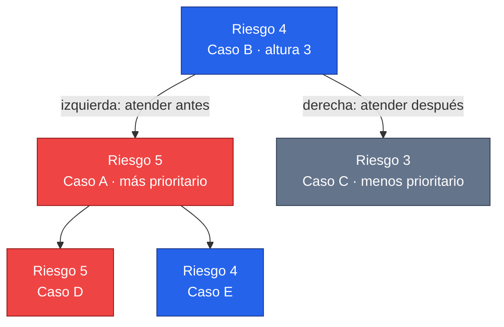
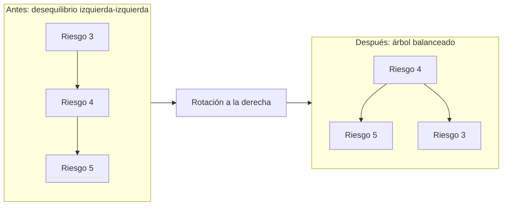
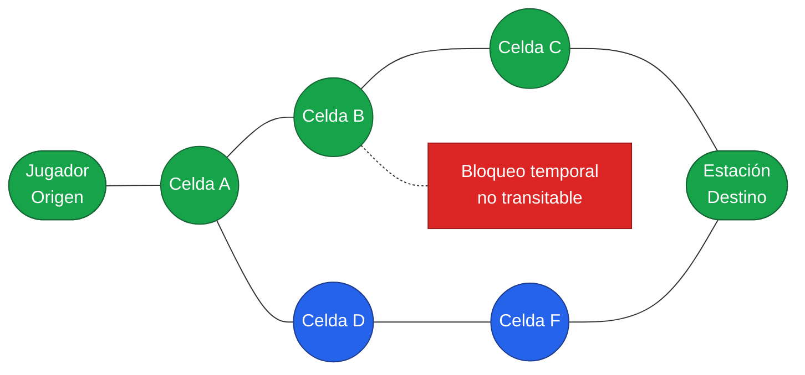

# Diagramas para diapositivas: AVL y grafo

Estos diagramas son ejemplos didácticos: muestran la lógica de las estructuras sin intentar dibujar todas las celdas del mapa ni todas las denuncias reales.

## Diapositiva: Árbol AVL de denuncias

**Idea que debe comunicar:** el árbol mantiene las denuncias ordenadas por prioridad y se rebalancea para no degradar el rendimiento.

### Texto breve para decir

> Cada nodo guarda una denuncia completa y su altura. A la izquierda van los casos que deben atenderse antes; a la derecha, los menos urgentes. Por eso, la denuncia prioritaria se obtiene recorriendo hasta el nodo más a la izquierda. Tras insertar o eliminar, el AVL revisa el factor de balance y rota cuando es necesario, manteniendo las operaciones principales en `O(log n)`.

### Rótulos sugeridos al presentar

- **Rojo:** mayor prioridad.
- **Azul:** nodo de comparación intermedio.
- **Gris:** menor prioridad.
- **Factor de balance:** `altura(izquierda) − altura(derecha)`; debe quedar entre `-1` y `1`.

## Diapositiva: Rotación AVL

**Idea que debe comunicar:** una rotación cambia la forma, no el orden de prioridades.

> Aunque la raíz cambia durante una rotación, el orden sigue siendo correcto: el caso de riesgo 5 permanece a la izquierda y continúa siendo el prioritario.

## Diapositiva: Grafo del piso y ruta mínima

**Idea que debe comunicar:** el mapa se transforma en nodos y conexiones; Dijkstra encuentra el camino más corto evitando obstáculos.

### Texto breve para decir

> Cada celda transitable del piso es un vértice y cada movimiento horizontal o vertical es una arista de costo uno. Los muros y bloqueos no se incluyen en la adyacencia. Dijkstra compara las distancias acumuladas y devuelve la secuencia de celdas más corta desde el jugador hasta la estación que exige el protocolo. Cuando aparece un bloqueo temporal, se reconstruye el grafo y se recalcula la ruta.

### Leyenda sugerida

- **Verde:** ruta seleccionada por Dijkstra.
- **Azul:** celdas transitables disponibles como alternativas.
- **Rojo punteado:** bloqueo que no puede ser recorrido.

## Diapositiva final: Conexión entre ambas estructuras

> El AVL decide **qué caso atender primero**; el grafo decide **cómo llegar a la estación necesaria para resolverlo**.
